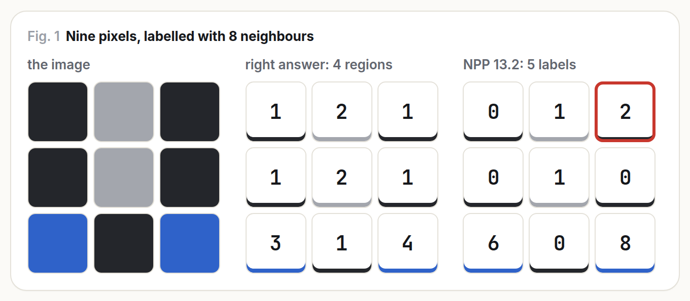
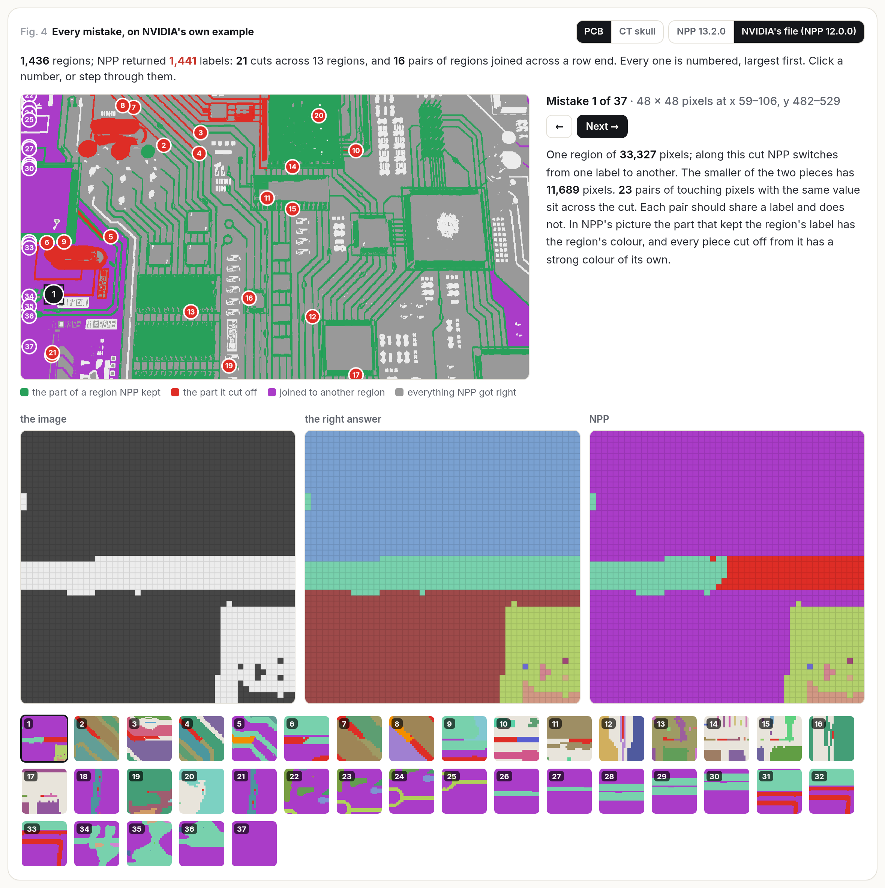
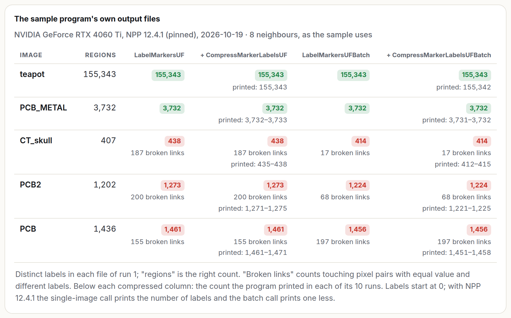
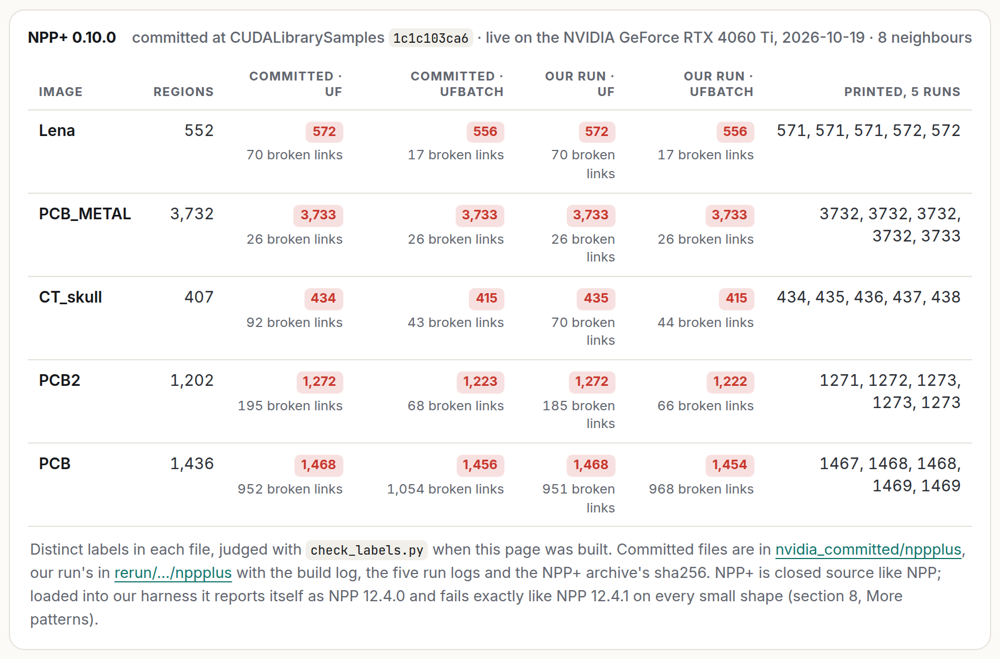
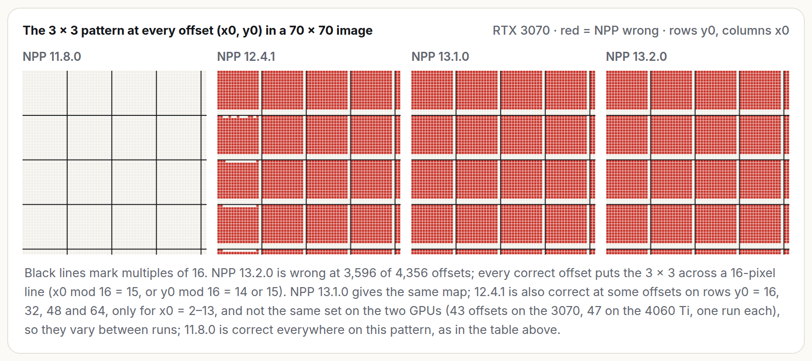
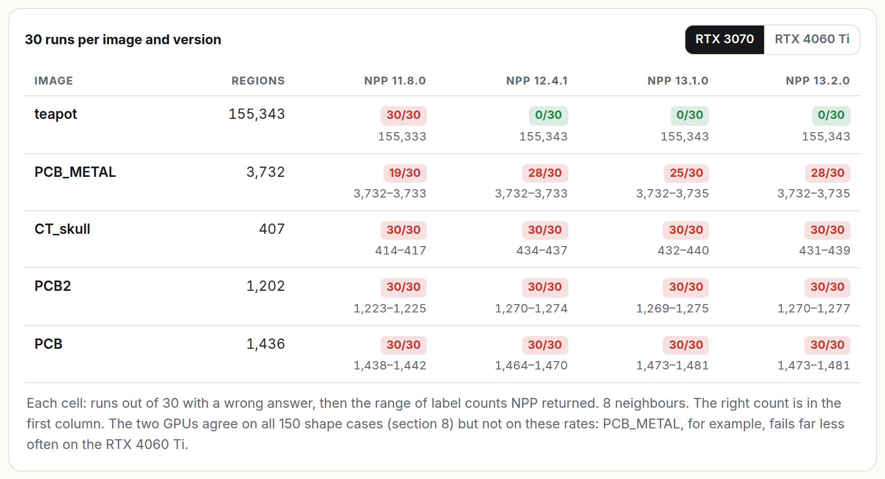
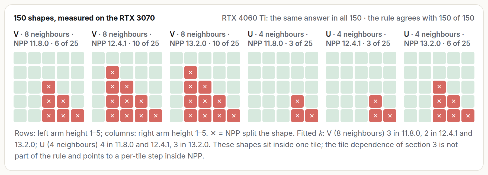

# nppiLabelMarkersUF splits connected regions

I was building a fast GPU labeller for construction drawings and tried NVIDIA NPP's union-find labeller,
`nppiLabelMarkersUF_8u32u_C1R_Ctx`, along the way. It kept returning more regions than my images had. This repo is
what I did to convince myself the problem is in NPP and not in my code, with every program, log and file, so you can
check it without trusting me.

The short version: NPP sometimes gives touching pixels of the same value different labels, so one region comes back
as several. A 3 x 3 image is enough to show it. It happens on NVIDIA's own sample images, in NVIDIA's own sample
program, and in the output files NVIDIA committed to its samples repo. I saw it in every version I tried, NPP 11.8.0
to 13.2.0, and in NPP+ 0.10.0, on an RTX 3070, an RTX 4060 Ti and an A100.

**Reported** as NVIDIA bug 6963973, on the
[developer forum](https://forums.developer.nvidia.com/t/386425), and on GitHub
([CUDALibrarySamples#374](https://github.com/NVIDIA/CUDALibrarySamples/issues/374),
[cuda-samples#468](https://github.com/NVIDIA/cuda-samples/issues/468)).

To rerun everything yourself: `bash repro/run_clean.sh` on any Linux machine with an NVIDIA GPU. It takes about ten
minutes and needs no CUDA toolkit ([more below](#run-it-yourself)).

## Nine pixels

```
0 2 0
0 2 0
1 0 1
```

With 8 neighbours this image has four regions: the five 0s (the bottom-middle 0 touches both columns through its
corners), the two 2s, and each 1 on its own. NPP 13.2.0 returns five. It writes each pixel's root index, so you can
see where it went wrong:

```
0 1 2
0 1 0
6 0 8
```

The top-right pixel is still its own root, even though the pixel below it was joined to root 0. The region of 0s got
cut in two.



[`repro/npp_min.cu`](repro/npp_min.cu) is that one call, made the way NVIDIA's own sample makes it, and exits with
status 2 when NPP is wrong:

```
$ nvcc -O2 repro/npp_min.cu -lnppif -lnppc -o npp_min && ./npp_min
NPP 13.2.0, NVIDIA GeForce RTX 3070 (sm_86), CUDA runtime 13040, driver supports 13000

   0 2 0    |   0 1 2
   0 2 0    |   0 1 0
   1 0 1    |   6 0 8

expected 4 regions, NPP gave 5: WRONG
```

I ran it 20 times per version on each machine:

| GPU, driver | 11.8.0 | 12.3.3 | 12.4.1 | 13.0.1 | 13.2.0 |
|---|---|---|---|---|---|
| RTX 3070, 580.159.03 | right 20/20 | | wrong 20/20 | | wrong 20/20 |
| RTX 4060 Ti, 580.173.02 | right 20/20 | | wrong 20/20 | wrong 20/20 | wrong 20/20 |
| A100-SXM4-40GB, 570.133.20 | right 20/20 | wrong 20/20 | wrong 20/20 | | |

11.8.0 gets this particular shape right, but fails the same way when the arms are one pixel taller.

## It isn't my code: NVIDIA's own files

A wrong answer from a vendor library is usually the caller's fault, so the next thing I did was take my code out of
the picture entirely.

cuda-samples has a program, `batchedLabelMarkersAndLabelCompressionNPP`, that labels five sample images with this
function, and NVIDIA committed the label files it wrote. I checked those files on the CPU, with no GPU involved at all:

- at tag v12.5, all 20 committed label files are wrong;
- at tag v12.8 (its run log says NPP 12.0.0), 16 of the 20 are wrong. Only PCB_METAL comes out right.

Here is every mistake in NVIDIA's committed PCB file. The green parts are what NPP kept of a region, the red parts
what it cut off:



I also built that sample unmodified from tag v12.5 against NPP 12.4.1 and ran it ten times, twice over, on the RTX
3070. It wrote between 12 and 16 wrong files out of 20 on every run. CT_skull, PCB2 and PCB were wrong every time, and
the label count it printed for CT_skull changed from run to run (433 to 437) though the image has 407 regions.



| image | regions | committed, v12.5 | committed, v12.8 | the sample on NPP 12.4.1 |
|---|---|---|---|---|
| teapot | 155,343 | 155,333 | 155,333 | right |
| PCB_METAL | 3,732 | 3,733 | right | 3,733 |
| CT_skull | 407 | 415 | 415 | 434 |
| PCB2 | 1,202 | 1,223 | 1,225 | 1,272 |
| PCB | 1,436 | 1,439 | 1,441 | 1,469 |

(The teapot file holds interleaved RGB bytes; the sample reads its first quarter as a grey image, so I check exactly
the bytes it labels.)

## NPP+ too

NPP+ ships the same sample in CUDALibrarySamples (`NPP+/batchedLabelMarkersAndCompression`). All 10 label files
committed with it are wrong, and building it against NPP+ 0.10.0 gives wrong files too, with CT_skull's count again
changing between runs (434 to 438). NPP+ 0.10.0 reports itself as NPP 12.4.0 and fails in exactly the places 12.4.1
does.



## Things I ruled out

My test program, [`npp_debug.cu`](docs/files/code/npp_debug.cu), loads each NPP version in turn and checks every call
against a CPU union-find. I changed one thing at a time:

| what I changed | result |
|---|---|
| scratch buffer zeroed, uninitialised, filled with 0xFF, or 4x and 16x the requested size | still wrong |
| output buffer pre-filled | still wrong |
| NULL stream, my own stream, `nppGetStreamContext` | still wrong |
| 8-, 16- and 32-bit input, other pixel values | still wrong |
| rows padded with `cudaMallocPitch` | still wrong |
| labels read before or after `nppiCompressMarkerLabelsUF` | still wrong |

The batch API, called as documented with two images per call, is wrong on 40 of 40 random 64 x 64 images, and so is
the single-image call on the same images, on 11.8.0, 12.4.1 and 13.2.0. Zero isn't treated as background either: it's
labelled like any other value.

To rule out version mix-ups, I redid the main runs installing each NPP from NVIDIA's pip wheels together with the CUDA
runtime of its own release, building with g++ and recording which libraries each binary actually loaded. Same results.

## When it fails

I moved the 3 x 3 to every position in a 70 x 70 image. On NPP 13.x it comes out right only where a 16-pixel grid line
cuts through it (x0 mod 16 = 15, or y0 mod 16 = 14 or 15), with no exceptions at any of the 4,624 positions, and none
in a 135 x 135 image either. So NPP seems to label in 16 x 16 tiles and then stitch the tiles together, and the
stitching is where regions get lost.



Inside a single tile, the wrong answer is the same every time. Once a region spans many tiles, the answer changes
from run to run, as if it depends on which threads finish first. That's why NVIDIA's sample prints a different count
on each run, and why the teapot, whose regions are tiny, always comes out right.



## A guess at the cause

NPP is closed source, so this is only what the output suggests. Since it writes each pixel's root, you can read its
union-find forest directly. It looks as if, when two trees meet, NPP re-points the neighbouring pixel (and sometimes
one or two above it) at the other tree's root, instead of re-pointing the neighbour's root. The old root then stays a
root of its own, which is exactly the top-right pixel in the nine-pixel example. A simple rule built on that idea
matches all 150 two-arm shapes I measured, but I fitted it to those shapes by hand, so treat it as a hint, not proof.



For comparison, a correct concurrent join finds both roots, points the larger at the smaller with an atomic min or
compare-and-swap, and retries if another thread got there first.

## Other odd things

- NPP 11.8.0, and NVIDIA's committed 12.0.0 files, join the last pixel of a row to the first pixel of the next when
  they have the same value, even though they don't touch. That's why the committed teapot has too few labels.
- The buffer-size queries overflow `int` far below the documented 4-gigapixel limit:
  `nppiLabelMarkersUFGetBufferSize_32u_C1R` returns -1,069,367,288 at 33,600 x 24,000, and
  `nppiCompressMarkerLabelsGetBufferSize_32u_C1R` returns -665,708,524 at 25,200 x 18,000, both with a success status,
  on 11.8.0, 12.4.1 and 13.2.0.

## Has this come up before?

Yes, several times. Two 2021 forum threads report regions being split
([184854](https://forums.developer.nvidia.com/t/184854), [188097](https://forums.developer.nvidia.com/t/188097)), and
the CUDA 11.5 release notes list a fix for "nppiLabelMarkersUF_8u32u_C1R column processing incorrect results". The
exact image from 184854 is labelled correctly by every version I tried, so this is either a different trigger or a fix
that didn't cover everything.

Before that, the older `nppiLabelMarkers` had similar problems in 2018 and 2019
([64673](https://forums.developer.nvidia.com/t/64673), [78668](https://forums.developer.nvidia.com/t/78668)), and in
2020 someone reported `nppiLabelMarkersUF` itself getting a region wrong
([158393](https://forums.developer.nvidia.com/t/158393)). More recently, people noticed that
`nppiCompressedMarkerLabelsUFInfo` returns different bounding boxes every time they run it on the same image
([267420](https://forums.developer.nvidia.com/t/267420) in 2023, [317834](https://forums.developer.nvidia.com/t/317834)
in 2024). Bounding boxes built from labels that change between runs would behave exactly like that. I couldn't test
their images, so I can't prove it's the same bug, but I'd bet on it.

It's easy to miss: the sample checks NPP's status codes but never the labels, images with small regions come out
fine, and when it's wrong the count is only off by a few percent.

## How I check a labelling

Label numbers are arbitrary, so comparing them is meaningless, and comparing only the number of labels can hide a cut
and a merge that cancel out. Instead I check the grouping: a labelling is wrong if two touching pixels of the same
value have different labels (a region was cut), or if one label covers two separate regions (regions were merged).
[`repro/check_labels.py`](repro/check_labels.py) does this on the CPU with SciPy:

```
$ python repro/check_labels.py PCB_1280x720_8u.raw 1280 720 8 PCB_LabelMarkersUF_8Way_1280x720_32u.raw
PCB_LabelMarkersUF_8Way_1280x720_32u.raw: truth 1436, file has 1441 labels, broken links 416, merged labels 4 -> WRONG
```

For NVIDIA's sample images I also labelled everything with cc3d 4.1.0 and with my own GPU labeller (on Apple Metal, a
different vendor entirely). All of them agree, and cc3d's files and mine are byte-identical.

## Run it yourself

```
bash repro/run_clean.sh
```

You need Linux, an NVIDIA driver, Python 3 with pip, g++ and git. It installs NPP 11.8.0, 12.4.1 and 13.2.0 from
NVIDIA's pip wheels, builds the tests against each, runs them, checks NVIDIA's committed files at both tags, builds and
runs NVIDIA's sample ten times, and writes a `summary.txt`. My output from it is in
[`docs/files/rerun/`](docs/files/rerun/).

Without a GPU, you can still check any label file with `repro/check_labels.py`.

## What I haven't tested

Hopper and Blackwell GPUs, Windows, NPP versions older than 11.8.0, and NPP+ on more than one GPU.

## What's in this repo

- [`repro/`](repro/): `npp_min.cu`, the label checker, and `run_clean.sh`, which reruns everything.
- [`docs/files/`](docs/files/): every input, every NPP output, NVIDIA's committed files, every log, and the pattern
  probes, with a [README](docs/files/README.md) describing each folder (including the details of how each run was set
  up) and [`SHA256SUMS`](docs/files/SHA256SUMS).
- [`docs/npp-labelmarkers-report.tar.gz`](docs/npp-labelmarkers-report.tar.gz): all of it as one download.

NVIDIA's sample images and committed output files are copied unchanged from
[NVIDIA/cuda-samples](https://github.com/NVIDIA/cuda-samples) and
[NVIDIA/CUDALibrarySamples](https://github.com/NVIDIA/CUDALibrarySamples), under their licences, so you can check my
judgements of them.

---

Gokul Adethya, [Fablnx](https://fablnx.com). The labeller I was building when I ran into this, and how it works:
[the Fablnx engineering blog](https://blogs.fablnx.com/posts/every-colour/).
